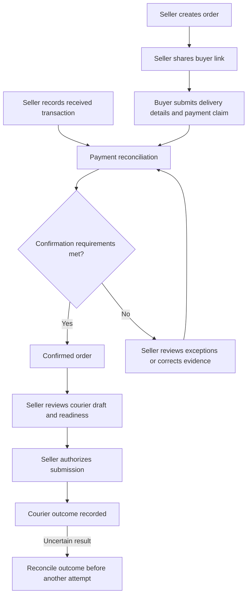
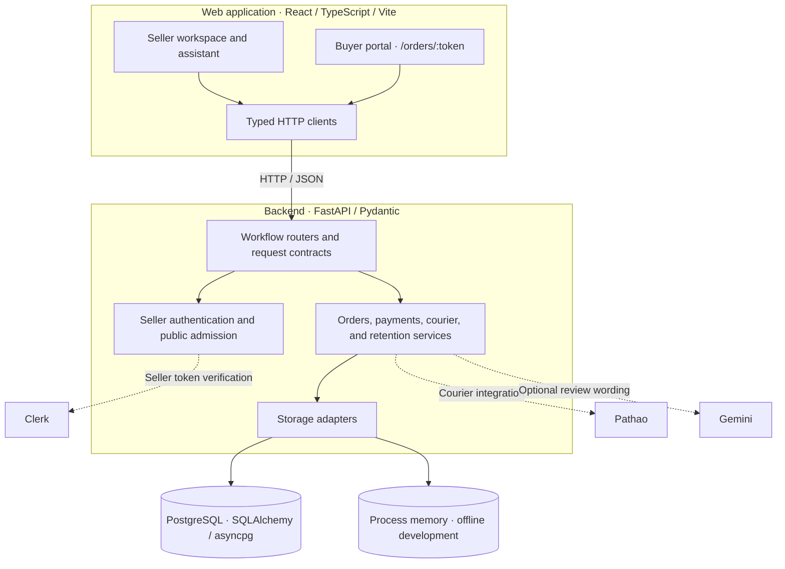

# Middleman

**Helping Bangladesh's social-commerce sellers turn a sale agreed in chat into an order ready for delivery.**

A customer messages your Facebook shop: “আপু, অর্ডার করতে চাই।” You agree on the
product and price. Then comes the work behind the sale: collecting an address,
checking a bKash or Nagad advance, working out the cash-on-delivery balance, and
getting the order ready for the courier. Another message arrives before you finish.

When you run a small shop, you are also the person answering questions, checking
payments, and preparing parcels. Details scattered across conversations mean more
follow-ups and more room for mistakes. For the buyer who has sent an advance,
knowing whether their order is confirmed matters too.

Middleman brings that work into one Bengali-and-English workspace. Sellers share
an order link; buyers review the agreed terms and submit delivery and payment
details. Sellers reconcile those claims against recorded payments and prepare
the order for courier handoff. The goal is simple: less time piecing an order
together, and more time caring for the business and the people buying from it.

[Overview](#overview) · [Competition](#competition) · [Architecture](#architecture) · [Quickstart](#quickstart) · [Configuration](#configuration) · [Development](#development) · [Documentation](#documentation)

> **Project status:** Under development. Production readiness and live-service
> acceptance remain unestablished. The credential-free quickstart launches the
> application; authenticated seller operations require additional configuration.

## Competition

Middleman is submitted to [Ostad Presents YUNet AIgnite Buildathon 2026](https://yunet-aignite26.devpost.com/),
a national AI hackathon for B2C solutions organized by Youth Upskill Network
(YUNet) for students in Bangladesh. The primary round runs from 1–5 November 2026.

The buildathon asks for a functional web app that solves a real-world consumer
problem with meaningful use of AI. Middleman addresses a services and productivity
problem for small social-commerce sellers: orders are agreed in chat, while
delivery details, payment claims, and courier preparation stay scattered across
conversations. The product brings that work into one Bengali-and-English
workspace, with a seller assistant that helps enter orders and transactions and
review payments while keeping seller confirmation in control of writes.

The required “Built for AIgnite 2026” sticker appears in the application header.
Submission materials include a hosted web app, a presentation deck of up to five
slides, and an optional product demo video.

## Overview

The product targets shops with one confirmation operator. Sellers define the
agreed order terms, share a buyer link, reconcile payment evidence, and review
courier readiness. Buyers receive a focused portal for their order rather than
having to repeat delivery and payment details across chat messages.

| Capability | Scope |
| --- | --- |
| Order management | Agreed product and payment terms, buyer links, search, date filters, and CSV export |
| Buyer portal | Order review, delivery information, payment claims, and Bengali/English presentation |
| Payment reconciliation | Recorded transactions, claim comparison, exception review, and remaining cash-on-delivery amounts |
| Work prioritization | Attention and delivery-preparation views for outstanding seller work |
| Courier operations | Pathao account settings, location selection, draft review, protected submission, and outcome reconciliation |
| Seller assistant | Guided order and transaction entry, work queries, and payment review with explicit confirmation before writes |

Payment claims, recorded receipts, and seller decisions remain distinct facts.
Reconciliation does not independently verify a payment with its provider.
Optional Gemini wording assists review; domain rules and seller confirmation
control the available actions.

### Order workflow



This diagram summarizes the main path, not the full lifecycle. Cancellation,
expiry, correction, retention, and retry rules are defined in the
[workflow contracts](docs/API_CONTRACTS.md). Buyer access requires the policy
described under [configuration](#configuration).

## Architecture

A React application provides separate seller and buyer experiences. Typed HTTP
clients call FastAPI routers organized by workflow; backend services own domain
rules, persistence, and external-provider interactions.



Storage paths depend on the configured mode. Durable mode checks database schema,
order-link encryption, and payment-marker protection at startup; process memory
supports offline development. Legacy item demos always use process memory.
Dashed edges identify external integrations, whose configuration and acceptance
are separate from running the application locally.

The stack uses React 19, strict TypeScript, Python 3.12, and Pydantic v2.
Verification combines Ruff, Mypy, pytest, Oxlint, Vitest, and local HTTP smoke.

See the [architecture guide](docs/ARCHITECTURE.md) for module ownership and data boundaries.

## Quickstart

### Prerequisites

- **Node.js 22.12+**; see [`.node-version`](.node-version).
- **Python 3.12** and **uv**.
- **Git** and network access for dependency installation.

Run from the repository root:

```sh
npm run setup
npm run doctor
```

Setup installs dependencies from `backend/uv.lock` and
`frontend/package-lock.json` and configures repository Git hooks. No root
`npm install` or cloud credentials are required for the local start.

Start the backend:

```sh
npm run dev:backend
```

In a second terminal, start the frontend from the repository root:

```sh
npm run dev:frontend
```

| Service | Default address |
| --- | --- |
| Web application | [localhost:5173](http://localhost:5173) |
| Interactive API documentation | [localhost:8000/docs](http://localhost:8000/docs) |
| API health | [localhost:8000/api/health](http://localhost:8000/api/health) |

Without credentials, expect the landing page, a signed-out workspace, and local
standby API endpoints. An authenticated seller session and working public buyer
links require the configuration below. If Vite selects another port, update CORS
and the Clerk authorized origin accordingly.

For installation issues, see [environment recovery](docs/agents/environment.md).

## Configuration

Use [`backend/.env.example`](backend/.env.example) and
[`frontend/.env.example`](frontend/.env.example) as references for local `.env`
files. Preserve existing settings, replace placeholders for the services you use,
and restart the affected server after changes.

| Area | Requirements |
| --- | --- |
| API connection | `VITE_API_BASE_URL` defaults to `http://localhost:8000/api`; backend `CORS_ORIGINS` allows frontend origins. |
| Seller authentication | `VITE_CLERK_PUBLISHABLE_KEY` on the frontend; trusted `CLERK_ISSUER` and verifier settings on the backend, with the correct authorized origin. |
| Durable storage | PostgreSQL connection settings, the required schema, `ORDER_LINK_ENCRYPTION_KEY`, and payment-marker protection. |
| Buyer access | Denied by default. The implemented link-possession policy is restricted to local synthetic self-tests with durable storage and verified seller authentication. |
| Courier integration | Pathao account settings, credential encryption, location environment, and booking controls. |
| Optional review generation | `REVIEW_GEMINI_ENABLED`, `GEMINI_API_KEY`, and `GEMINI_MODEL`. Self-test mode disables AI; public chat and idea demos remain local mocks. |

Private credentials belong on the backend. All `VITE_*` values are exposed to the
browser and must contain only public configuration.

The [self-test reference](docs/phase-1-self-test.md) documents the restricted buyer
policy and integration prerequisites. It is a historical plan, not a completed
acceptance report or a production deployment guide.

### Operational boundaries

- Offline development and unit tests do not require live-provider credentials.
  Development identities and test overrides do not establish live authentication.
- In-memory records disappear on restart and are not shared across workers.
  Configuring a database does not make legacy `/api/items` records durable.
- Legacy demo clients can simulate responses after network failures; those
  responses do not establish a successful server write.
- Configuration flags and local checks do not establish hosted authentication,
  database concurrency, live-provider reliability, or browser/device acceptance.

## Development

Use root commands to preserve workspace cache and lockfile handling.

| Command | Purpose |
| --- | --- |
| `npm run setup` | Install locked dependencies and configure Git hooks |
| `npm run doctor` | Check prerequisites and installed dependency metadata |
| `npm run check` | Run the complete local verification gate |
| `npm run conventions` | Check file sizes, documentation links, and repository rules |
| `npm run lint` | Run backend and frontend linters |
| `npm run typecheck` | Check Python and TypeScript types |
| `npm run build` | Build the frontend |
| `npm run context` | List source paths for bounded code exploration |

Run focused tests while editing:

```sh
npm run test:backend -- tests/test_health.py
npm run test:frontend -- src/services/api.test.ts
```

Run `npm run check` before handing off code. The gate covers tooling, conventions,
lint, types, backend/frontend tests, production build, and local HTTP smoke.
Results are written to `.cache/checks/<run>/result.json`, with adjacent stage logs.
Browser, device, PostgreSQL integration, hosted authentication, and live-provider
acceptance are separate gates; see [verification scope](docs/agents/verification.md).

### Repository structure

```text
frontend/src/
  features/          Seller, buyer, locale, landing, assistant, and demo UI
  components/        Shared interface components
  services/          Shared API helpers and legacy demo clients
backend/
  app/api/           Workflow routers
  app/models/        Pydantic contracts
  app/services/      Domain services, storage adapters, and integrations
  app/core/          Configuration, authentication, database, and tokens
  migrations/        SQL schema migrations
  tests/             Backend tests and integration harnesses
scripts/             Workspace tooling and verification
docs/                Architecture, contracts, and verification references
tasks/               Task and handoff templates
```

## Documentation

| Reference | Contents |
| --- | --- |
| [Product context](PRODUCT.md) | Audience, scope, and product principles |
| [Architecture](docs/ARCHITECTURE.md) | Ownership, data flow, and storage boundaries |
| [API contracts](docs/API_CONTRACTS.md) | Order, payment, buyer, courier, and assistant rules |
| [Repository conventions](docs/CONVENTIONS.md) | File size, ownership, and work-storage rules |
| [Documentation index](docs/README.md) | Detailed references and historical evidence |

## Contributing

Read [AGENTS.md](AGENTS.md) and the relevant workflow contract before changing
behavior. Trace callers and tests, keep changes focused, and add regression
coverage for bugs and changed domain logic. Run focused checks during development
and the full gate before handoff, recording failed, blocked, and unrun checks.
Use the [task template](tasks/task-template.md) for work spanning multiple sessions.

## License

No project license file is included. Reuse and redistribution terms have not been
specified; do not assume an open-source license.
