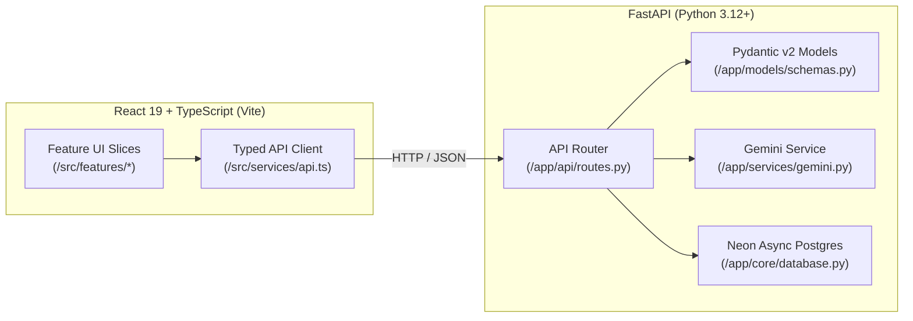

# System Architecture & Design Guide

> [!NOTE]
> This document is part of **Tier 2 (On-Demand Context)**. Agents should read this file when designing new features, modifying state management, or altering the communication bridge between frontend and backend.

---

## 1. High-Level Architecture Overview

This project is a decoupled full-stack application optimized for fast iterative development and deterministic agentic verification:



---

## 2. Key Architectural Invariants

### Feature-Slice Colocation
* **Frontend:** Avoid horizontal slicing (e.g., placing all hooks in one folder, all components in another). Instead, colocate components, custom hooks, types, and domain-specific tests under `src/features/<feature-name>/`.
* **Modularity (< 250 Lines):** Deconstruct components exceeding 250 lines into sub-components or custom hooks.

### Graceful Standby / Mock-First Pattern
* In development or evaluation, live cloud credentials (`GEMINI_API_KEY`, `DATABASE_URL`) may be omitted.
* Both frontend and backend implement graceful fallbacks:
  * Backend returns simulated responses if Gemini or Database is disconnected.
  * Frontend handles network failures with fallback mock fixtures in `src/services/api.ts`.
* Tests **must never** depend on live internet connections or production secrets.
* Current item routes always use process memory; database configuration alone does
  not enable persistence. Clerk settings are scaffolding, not an implemented
  authentication boundary. See [API boundaries](API_CONTRACTS.md#4-current-demo-boundaries).

### Verification-Driven Delivery
* Always verify system integrity after implementing features:
  ```bash
  npm run check
  ```
