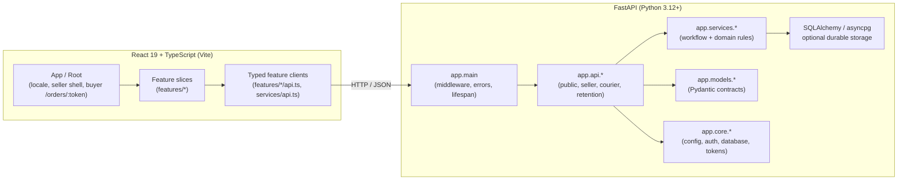

# System Architecture & Design Guide

> [!NOTE]
> This document is part of **Tier 2 (On-Demand Context)**. Read it when designing
> a feature, changing state ownership, or altering the frontend/backend boundary.
> Size, ownership, and storage rules are in [repository conventions](CONVENTIONS.md).

## 1. High-level architecture

This is a decoupled React/FastAPI application with feature-owned frontend slices
and workflow-owned backend routers and services:



## 2. Frontend ownership

- `frontend/src/features/seller/` owns the seller workspace, order creation and
  detail, buyer links, payments, corrections, reconciliation, retention, and courier
  review. Colocated hooks and tests stay with the screen or workflow they serve.
- `frontend/src/features/buyer/` owns the public `/orders/:token` portal, buyer
  submission and corrections, Pathao location choices, and public status projection.
- `frontend/src/features/locale/` owns Bengali/English copy, formatting, and the
  typed locale provider. Keep business values out of translation catalogs.
- `frontend/src/features/{demo,gemini,items}/`, `components/`, and `services/`
  retain the reachable template demos and shared typed API helpers.
- `Root.tsx` and `App.tsx` compose provider/session state and route between the
  seller shell and buyer portal. Feature components do not fetch history directly
  when a colocated hook already owns the request lifecycle.

## 3. Backend ownership

Routers are split by workflow rather than one central routes module:

| Router | Prefix and responsibility |
| --- | --- |
| `api/routes.py` | `/api` health, Gemini demos, in-memory items, team sample |
| `api/seller.py` | `/api/seller` shop/account/session/bootstrap endpoints |
| `api/orders.py` | `/api/seller` order creation, decisions, buyer details, history |
| `api/order_export.py` | `/api/seller/orders` search, date filtering, CSV export |
| `api/link_access.py` | `/api/seller/orders` buyer-link revoke/reissue |
| `api/public_orders.py` | `/api/public/orders` public reads, submission, Pathao locations |
| `api/transactions.py` | `/api/seller/transactions` listing, comparison, corrections |
| `api/sms.py` | `/api/seller/transactions` SMS import and parsing |
| `api/courier.py` | `/api/seller/orders` courier drafts, submission, reconciliation |
| `api/pathao.py` | `/api/seller/courier/pathao` account, catalog, location settings |
| `api/structured_retention.py` | `/api/seller/retention/structured` retention status/cleanup |

Service modules keep separate responsibilities: order creation/search/mapping,
buyer revisions and projections, payment matching/allocation/decisions,
reconciliation (memory and SQL), courier drafts/review/reservation/attempts/
outcomes, Pathao connections/catalog/locations/transport, and raw/structured
retention. Shared auth, idempotency, public admission, database, and token logic
stay under `app/core/`. Models are split by workflow (`order`, `buyer`, `courier`,
`pathao`, `payment_decision`, `retention`, ...); `models/schemas.py` holds the
template demo contracts.

## 4. Architectural invariants

### Feature and workflow colocation

Avoid horizontal slicing. Put feature UI, hooks, types, and tests under
`frontend/src/features/<feature>/`, and keep backend routes/services/models with
the workflow they own. Split a file by responsibility, not by line count alone.
The review trigger and maximum are in [conventions](CONVENTIONS.md).

### Offline standby and optional durability

- Development and unit tests work without live credentials. Backend tests block
  non-loopback sockets, clear provider inputs, and reset in-memory demo records.
- Item routes always use process memory. A database URL alone does not make item
  records durable or enable authentication.
- Durable mode verifies database schema, order-link encryption, and payment-marker
  readiness at startup. Configuration flags report configuration, not successful
  provider calls or deployment readiness.
- Frontend fallbacks can simulate results on network failure. A rendered fallback
  is not proof of a server write.

### Verification-driven delivery

Run focused tests while changing behavior, then the root gate before handoff:

```sh
npm run check
```

The gate runs tooling tests, repository conventions, backend lint/types/tests,
frontend lint/tests/build, and local HTTP smoke. Browser, PostgreSQL, Clerk, Gemini,
and Pathao sandbox/live checks remain separate and must be reported as run or not
run. See the [verification reference](agents/verification.md).

## 5. Seller evidence resolution

Receipt comparison and resolution use typed seller-only contracts. The PostgreSQL
audit log stores structured resolution decisions; observations remain immutable.
Rejected claim revision IDs, rather than order IDs alone, hold alternatives without
giving a decision authority over future revisions. Exact reconciliation continues
enforcing amount, sender, receiving account, time, and single-use rules. Resolution
never changes an accepted allocation.

Claim admission, manual/SMS observations, seller resolution, and recovery
reconciliation acquire the shop row lock before order/receipt locks. Same-shop
writes therefore serialize, including absent receipt identities. This trades
throughput on unrelated payments within a shop for a consistent known-claims
snapshot in the single-operator model. Comparison loads review reasons in bulk
while the mutation holds the lock. Resolution audit, allocation, and idempotent
outcome commit together.

The memory adapter remains for offline tests. Durable acceptance is separately
checked against isolated loopback PostgreSQL schemas. Synthetic browser adapters
never enable public access or establish live authentication readiness.

Unallocated receipt edits share the shop lock and commit correction audit, appended
observation, old/new claim reconciliation, and idempotent response together.
Serialization failures retry the whole correction. Identity collisions fail without
merging or creating funds. Migration `0009_observation_identity.sql` backfills
immutable observed provider/TrxID snapshots before receipt identities can change.
Indexed observation identity lookup prevents reimporting an original identity as
another payment after correction. Retained identities become minimal used-payment
markers at allocation; matching checks each marker before acceptance. Structured
correction history uses existing audit records and retention rules; raw SMS is not
copied.

Manual payment approval binds order and receipt versions to a server-derived
preview. The shared allocator writes receipt allocation, retained-identity markers,
confirmation, audit, and anonymous shop counters inside the shop lock. Manual
approval never overrides unresolved evidence, competing/held claims, prior use, or
the total cap. The enclosing transaction persists the idempotent result; rollback
and replay cannot increase counters independently. Migration 0010 backfills counts
from existing allocations. Private decision history remains separate from
aggregate-only metrics and public buyer projections.

## 6. Pathao connection boundary

Merchant settings use the narrow async `pathao_provider` adapter and a dedicated
`pathao_secrets` encryption boundary, separate from receiving-payment accounts.
`pathao_connections` appends shop/environment revisions (migration 0021), verifies
store membership outside transactions, then compares versions under the shop lock.
No booking operations exist here. See
[the Pathao account contract](pathao-account-contract.md).
