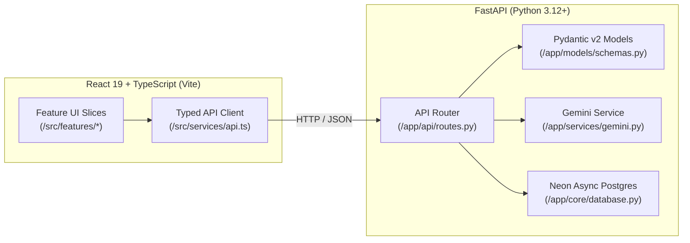

# System Architecture & Design Guide

> [!NOTE]
> This document is part of **Tier 2 (On-Demand Context)**. Agents should read this file when designing new features, modifying state management, or altering the communication bridge between frontend and backend.

---

## 1. High-Level Architecture Overview

This project is a decoupled full-stack application optimized for fast iterative development and deterministic agentic verification:



---

## 2. Key Architectural Invariants

### Feature-Slice Colocation
* **Frontend:** Avoid horizontal slicing (e.g., placing all hooks in one folder, all components in another). Instead, colocate components, custom hooks, types, and domain-specific tests under `src/features/<feature-name>/`.
* **Modularity (< 250 Lines):** Deconstruct components exceeding 250 lines into sub-components or custom hooks.

### Graceful Standby / Mock-First Pattern
* In development or evaluation, live cloud credentials (`GEMINI_API_KEY`, `DATABASE_URL`) may be omitted.
* Both frontend and backend implement graceful fallbacks:
  * Backend returns simulated responses if Gemini or Database is disconnected.
  * Frontend handles network failures with fallback mock fixtures in `src/services/api.ts`.
* Tests **must never** depend on live internet connections or production secrets.
* Current item routes always use process memory; database configuration alone does
  not enable persistence. Clerk settings are scaffolding, not an implemented
  authentication boundary. See [API boundaries](API_CONTRACTS.md#4-current-demo-boundaries).

### Verification-Driven Delivery
* Always verify system integrity after implementing features:
  ```bash
  npm run check
  ```


## Seller evidence resolution

Receipt comparison and resolution use typed seller-only contracts. The existing
PostgreSQL audit log stores structured resolution decisions; observations remain
immutable. Rejected claim revision IDs, rather than order IDs alone, hold alternatives
without giving a decision authority over future revisions. Exact reconciliation
continues enforcing amount, sender, receiving account, time and single-use rules.
Resolution never changes an accepted allocation.

Claim admission, manual/SMS observations, seller resolution and recovery reconciliation
acquire the shop row lock before order/receipt locks. Same-shop writes therefore
serialize, including absent receipt identities. This trades throughput on unrelated
payments within a shop for a consistent known-claims snapshot in Phase 1's single
operator model. Higher write volume would require coordinated payment-identity locks
across every writer, including identities without a receipt; narrowing one path alone
would weaken the boundary. Comparison loads review reasons in bulk while the mutation
holds the lock. Resolution audit, allocation and idempotent outcome commit together.

The memory adapter remains for offline tests. Durable acceptance is separately checked
against isolated loopback PostgreSQL schemas. Synthetic browser adapters never enable
public access or establish live authentication readiness for deployment.

Unallocated receipt edits share that shop lock and commit correction audit, appended
observation, old/new claim reconciliation and idempotent response together. Serialization
failures retry the whole correction. Identity collisions fail without merging or
creating funds. Migration `0009_observation_identity.sql` backfills immutable observed
provider/TrxID snapshots before receipt identities can change. Historic observations
from a different identity cannot be selected by resolution. Structured correction
history uses existing audit records and retention rules; raw SMS is not copied.
Indexed observation identity lookup also prevents reimporting an original identity
as another payment after correction. All retained identities are consumed as minimal
used-payment markers at allocation; matching checks each marker before acceptance.


Manual payment approval binds order and receipt versions to a server-derived preview.
The shared allocator writes full receipt allocation, retained-identity markers,
confirmation, audit and anonymous shop counters inside the existing shop lock.
Manual approval never overrides unresolved evidence, competing/held claims, prior
use or the total cap. The enclosing transaction also persists the idempotent result;
rollback and replay cannot increase counters independently. Migration 0010 backfills
counts from existing allocations. Private decision history remains separate from
aggregate-only metrics and public buyer projections.

## Pathao connection boundary

Merchant settings use the narrow async `pathao_provider` adapter and dedicated
`pathao_secrets` encryption boundary, separate from receiving-payment accounts.
`pathao_connections` appends shop/environment revisions (migration 0021), verifies
store membership outside transactions, then compares versions under the shop lock.
No booking operations exist here. See [contracts and source-review limits](pathao-account-contract.md).

