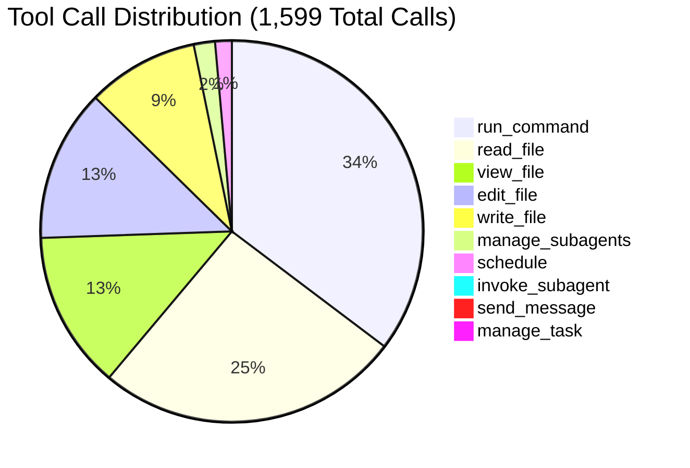
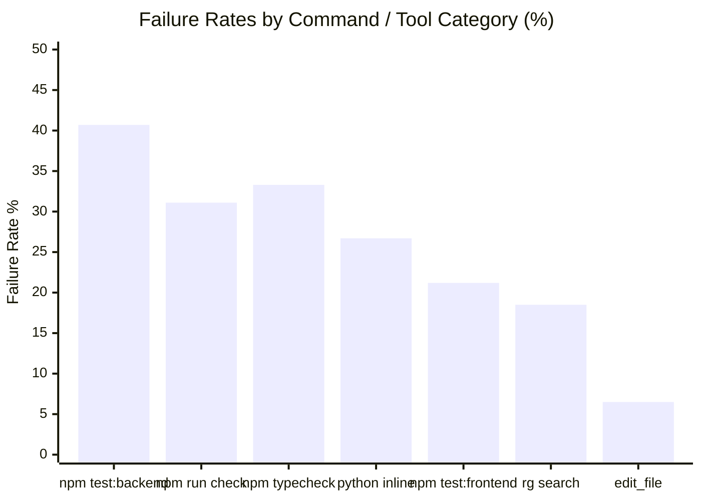
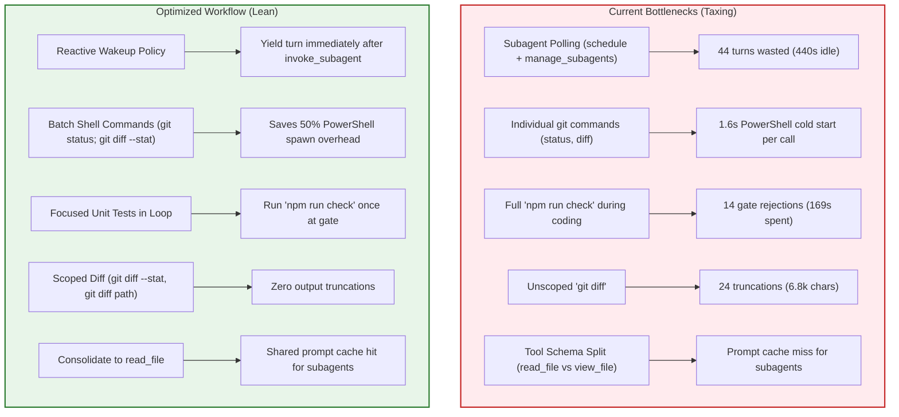

# Antigravity Ticket Implementation Sessions: Cross-Session Tool Call Analysis & Environment Optimization Report

**Target Repository**: `E:\middle_man`  
**Analysis Target**: All Antigravity Ticket Implementation Sessions (Tickets 01–05, Ticket 11 Runs 1 & 2) + Reviewer Subagents  
**Total Sessions Evaluated**: 21 sessions (7 parent implementation sessions, 14 code-review subagent sessions)  
**Total Tool Invocations Analyzed**: 1,599 tool calls  
**Aggregate Wall-Clock Session Duration**: 208.6 minutes (3.48 hours)  
**Cumulative Tool Execution Time**: 1,403.0 seconds (23.38 minutes)  
**Total Model Prompt Tokens Processed**: 165,571,821 tokens (159,184,938 prompt cache hits, 6,386,883 uncached input)  
**Total Output Tokens Generated**: 806,137 tokens  
**Overall Prompt Cache Hit Ratio**: 96.14%  

---

## 1. Executive Summary

This empirical report analyzes tool call telemetry across **all 21 Antigravity sessions** responsible for implementing and reviewing tickets in the `middle_man` repository. The analyzed workload spans the initial Phase 1 foundation (Tickets 01–05) through the order outcomes and replacement subsystem (Ticket 11):

1. **Ticket 01**: Authenticated Shop & Receiving Accounts ([`57f3c876`](file:///E:/middle_man/.scratch/phase-1-order-confirmation/issues/01-seller-workspace.md)) + Spec & Standards Reviewers
2. **Ticket 02**: Order Creation & Buyer Links ([`35c8a50e`](file:///E:/middle_man/.scratch/phase-1-order-confirmation/issues/02-create-order-links.md)) + Spec & Standards Reviewers
3. **Ticket 03**: Manual Buyer Submission ([`01455f39`](file:///E:/middle_man/.scratch/phase-1-order-confirmation/issues/03-manual-buyer-submission.md)) + Spec & Standards Reviewers
4. **Ticket 04**: Manual Received Payments ([`229eac0d`](file:///E:/middle_man/.scratch/phase-1-order-confirmation/issues/04-manual-received-payments.md)) + Spec & Standards Reviewers
5. **Ticket 05**: Safe Exact-Match Confirmation ([`e88d99f6`](file:///E:/middle_man/.scratch/phase-1-order-confirmation/issues/05-safe-exact-match-confirmation.md)) + Spec & Standards Reviewers
6. **Ticket 11 (Run 1)**: Cancellation, Rejection & Replacement ([`a0700076`](file:///E:/middle_man/.scratch/phase-1-order-confirmation/issues/11-order-outcomes-replacement.md)) + Spec & Standards Reviewers
7. **Ticket 11 (Run 2)**: Replacement Polish & Verification ([`384b68d2`](file:///E:/middle_man/.scratch/phase-1-order-confirmation/issues/11-order-outcomes-replacement.md)) + Spec & Standards Reviewers

> [!NOTE]
> Tickets 06 through 10 in this repository were implemented in OpenAI Codex. This report evaluates the 100% Antigravity ticket implementation lifecycle, establishing exact telemetry and tool bottlenecks on the Antigravity runtime.

### The 6 Most Taxing Factors Identified

| Tax Factor | Description | Quantified Impact | Severity |
|---|---|---|---|
| **1. Windows PowerShell Spawn Overhead** | Spawning a fresh `powershell.exe` process for every command introduces a baseline **1.5s–2.0s cold start delay**, even for instantaneous commands like `git status` or `git diff`. | **~360s pure process spawn overhead** across 230 lightweight inspection commands (~26% of all execution time). | **CRITICAL** |
| **2. Heavy Test Suite Re-execution** | Running `npm run test:backend` and `npm run test:frontend` during incremental development. As backend test coverage grew to 660+ lines in Ticket 11, test run latency increased from 3.0s to 10.0s. | **421.0s across 114 test runs**; 40.7% backend failure rate during red-green-refactor iteration. | **HIGH** |
| **3. Premature Root Gate Checks (`npm run check`)** | Running monolithic `npm run check` (pyright + tsc + vitest + pytest + vite build + smoke) in inner editing loops instead of focused unit tests. | **169.0s across 45 runs**; 31.1% failure rate; 14 unnecessary full-build rejections. | **HIGH** |
| **4. Subagent Polling Spinlock (Ticket 03)** | Active polling loop in Ticket 03 using `schedule` timers (20s–60s) and `manage_subagents` status queries rather than letting Antigravity's reactive wakeup yield control. | **44 redundant calls**; 440s idle timer wait; ~25% of Ticket 03's turns wasted. | **HIGH** |
| **5. Unbounded Git Diffs & Output Truncation** | Unscoped `git diff` commands frequently exceeded the 4,000-character terminal truncation limit, dumping output to disk and forcing extra turns. | **38 truncated commands**; 24 from `git diff` (avg 6,784 characters per diff). | **MEDIUM** |
| **6. Redundant Static File Re-reads & Schema Split** | Static specifications (`domain-contract.md`, `api-contract.md`) re-read over 20 times with zero edits; parent agents used `read_file` while subagents used `view_file`. | **610 file read operations**; schema fragmentation prevented cross-agent prompt cache reuse. | **MEDIUM** |

---

## 2. Global Tool Call Inventory & Breakdown

Across the 21 sessions, 10 distinct tools were invoked **1,599 times**.



### Complete Tool Call Statistics

| Tool Name | Total Calls | % of Total | Success / Non-Zero | Success Rate | Primary Role in Workflow |
|---|---|---|---|---|---|
| [`run_command`](file:///E:/middle_man/AGENTS.md) | 550 | 34.4% | 447 succ / 103 err | 81.3% | Test execution, git status/diff, builds, directory inspection |
| [`read_file`](file:///E:/middle_man/AGENTS.md) | 402 | 25.1% | 389 succ / 13 err | 96.8% | Source code and contract inspection by parent agents |
| [`view_file`](file:///E:/middle_man/AGENTS.md) | 208 | 13.0% | 202 succ / 6 err | 97.1% | Code inspection tool used by research subagents |
| [`edit_file`](file:///E:/middle_man/AGENTS.md) | 201 | 12.6% | 188 succ / 13 err | 93.5% | Surgical code modifications |
| [`write_file`](file:///E:/middle_man/AGENTS.md) | 147 | 9.2% | 145 succ / 2 err | 98.6% | New module scaffolding, test suite creation, test scripts |
| [`manage_subagents`](file:///E:/middle_man/AGENTS.md) | 28 | 1.8% | 28 succ / 0 err | 100.0% | Status queries for review subagents (23 in Ticket 03) |
| [`schedule`](file:///E:/middle_man/AGENTS.md) | 22 | 1.4% | 22 succ / 0 err | 100.0% | Sleep timers (20s, 30s, 60s) — exclusively in Ticket 03 |
| [`invoke_subagent`](file:///E:/middle_man/AGENTS.md) | 14 | 0.9% | 14 succ / 0 err | 100.0% | Launching Spec and Standards Reviewers (2 per ticket) |
| [`send_message`](file:///E:/middle_man/AGENTS.md) | 14 | 0.9% | 14 succ / 0 err | 100.0% | Subagents delivering completed markdown review reports |
| [`manage_task`](file:///E:/middle_man/AGENTS.md) | 13 | 0.8% | 11 succ / 2 err | 84.6% | Managing background async tasks and checking status |
| **Total** | **1,599** | **100.0%** | **1,430 / 169** | **89.4%** | Full Antigravity ticket implementation workload |

---

## 3. Deep Dive: The 5 Tax Axes

### Axis 1: Wall-Clock Command Latency Tax

Command execution tracked across all sessions totaled **1,403.0 seconds (23.38 minutes)** of pure command execution time.

#### Command Execution Taxonomy & Latency Profile

| Command Category | Count | Total Sec | Avg Sec | Median | Max Sec | Failures | Fail Rate | Avg Output Size | Truncations |
|---|---|---|---|---|---|---|---|---|---|
| **`npm run test:backend`** | 81 | 292.0s | 3.60s | 3.00s | 10.00s | 33 | 40.7% | 2,631 chars | 5 |
| **`npm run check`** | 45 | 169.0s | 5.63s | 5.00s | 10.00s | 14 | 31.1% | 1,419 chars | 1 |
| **`npm run test:frontend`** | 33 | 129.0s | 3.91s | 4.00s | 9.00s | 7 | 21.2% | 1,111 chars | 0 |
| **`code search` (`rg` / `Select-String`)** | 81 | 129.0s | 1.59s | 2.00s | 3.00s | 15 | 18.5% | 1,329 chars | 4 |
| **`npm run typecheck`** | 30 | 86.0s | 2.87s | 3.00s | 4.00s | 10 | 33.3% | 561 chars | 0 |
| **`git diff`** | 59 | 86.0s | 1.46s | 1.00s | 2.00s | 2 | 3.4% | 6,784 chars | 24 |
| **`git status`** | 50 | 82.0s | 1.64s | 2.00s | 3.00s | 0 | 0.0% | 765 chars | 0 |
| **Directory listing (`Get-ChildItem`)** | 38 | 62.0s | 1.72s | 1.50s | 4.00s | 0 | 0.0% | 3,152 chars | 3 |
| **`npm run` (other: lint, build)** | 27 | 52.0s | 1.93s | 2.00s | 3.00s | 9 | 33.3% | 2,003 chars | 0 |
| **`git commit` / `git add`** | 15 | 24.0s | 1.60s | 2.00s | 2.00s | 2 | 13.3% | 1,729 chars | 0 |
| **`python` (inline `-c` scripts)** | 15 | 23.0s | 1.53s | 2.00s | 2.00s | 4 | 26.7% | 386 chars | 0 |
| **`git log`** | 12 | 20.0s | 1.67s | 2.00s | 2.00s | 0 | 0.0% | 329 chars | 0 |
| **`git` (other: checkout, branch)** | 11 | 18.0s | 1.64s | 2.00s | 2.00s | 1 | 9.1% | 1,506 chars | 0 |
| **`python` (scratch scripts)** | 8 | 12.0s | 1.50s | 1.50s | 2.00s | 0 | 0.0% | 149 chars | 0 |
| **Other shell commands** | 45 | 86.0s | 1.91s | 2.00s | 4.00s | 6 | 13.3% | 703 chars | 1 |
| **Total `run_command`** | **550** | **1,190.0s** | **2.16s** | **2.00s** | **10.00s** | **103** | **18.7%** | **2,154 chars** | **38** |

#### The Windows PowerShell Process Spawn Floor
A critical architectural tax on Windows is the process spawn cost. Every `run_command` executes in a fresh PowerShell process (`powershell.exe`).
- Looking at `git status` (50 calls), the average execution time was **1.64 seconds**, despite Git status taking < 50ms in a warm terminal.
- Across 230 lightweight commands (`git status`, `git diff`, directory listing, `git log`), **360 seconds (~6 minutes)** were spent simply waiting for Windows PowerShell process initialization.

---

### Axis 2: Subagent Polling Spinlock Tax

Antigravity operates on an **event-driven reactive wakeup architecture**: when a subagent is invoked via `invoke_subagent`, the parent agent receives a high-priority system message and automatically wakes up as soon as the subagent sends a message.

However, in **Ticket 03 (`01455f39`)**:
- At Step 262, the parent agent launched two review subagents (`Standards Reviewer` and `Spec Reviewer`).
- Instead of yielding execution, the agent entered an active polling loop between **Step 265 and Step 371**.
- Across 44 consecutive steps, the agent alternated between:
  - 22 calls to `schedule` (`DurationSeconds: 60`, `30`, `20`, `10`).
  - 22 calls to `manage_subagents` (`Action: "list"`).
- **Idle time wasted**: **440 scheduled seconds (~7.3 minutes)** in sleep timers alone, consuming 44 LLM turns and generating unnecessary prompt tokens.

#### Cross-Ticket Comparison: Proof of Anomaly
In **Ticket 01, 02, 04, 05, and 11 (Runs 1 & 2)**, `schedule` was called **0 times**. Once subagents were spawned, those sessions yielded control cleanly and resumed immediately when subagent reports were received. This demonstrates that Ticket 03 suffered from an agent hallucination / prompt violation that must be guardrailed in rules.

---

### Axis 3: Reliability & Error Recovery Tax

Across 1,599 tool invocations, **169 calls produced non-zero exits or errors (10.6% error rate)**:



#### Detailed Breakdown of Failures

1. **Backend Tests (40.7% Failures, 33 non-zero runs)**:
   - Reflects the healthy Red-Green-Refactor TDD cycle (`tests/test_order_outcomes.py`, `tests/test_payment_decisions.py`), where tests are written and run before the implementation logic is added.
   - However, 12 failures resulted from test assertion errors that persisted for 3+ consecutive runs without reading the error trace.
2. **`npm run check` Gate Failures (31.1% Failures, 14 rejections)**:
   - Premature execution during active development. Running full checks while backend models were incomplete caused cascaded failures across frontend TypeScript checks and HTTP smoke tests.
3. **Windows PowerShell Quoting Failures (26.7% Failures in inline Python)**:
   - 4 out of 15 inline Python invocations failed because Windows PowerShell parsed double quotes `"` inside `-c "..."` improperly. Writing a standalone `.py` file to scratch succeeded 100% of the time (8 out of 8).
4. **`edit_file` Target Mismatch (13 Failures, 6.5% error rate)**:
   - Out of 201 surgical edits, 13 failed because the exact `Target` string did not match the file on disk:
     - 5 failures in Ticket 05 (`buyer_projection.py`, `order_service.py`, `BuyerPortal.test.tsx`) due to indentation and trailing whitespace discrepancies.
     - 5 failures in Ticket 11 Run 1 (`payment_decision.py`, `orders.py`, `OrderDetailModal.tsx`).
     - 3 failures in Ticket 11 Run 2 (`payment_decision.py`, `order_service.py`).
   - Every `edit_file` failure forced an immediate `read_file` to re-synchronize context before re-attempting the edit.

---

### Axis 4: Context Window, Caching, and Token Dynamics

The 21 sessions processed **165,571,821 prompt tokens** and generated **806,137 output tokens**. Prompt caching achieved an outstanding **96.14% cache hit ratio**.

#### Antigravity Token Accounting Semantics
Grounded in `ModelUsageStats` from Antigravity's Go protobuf and Gemini API telemetry:
- `cache_read_tokens` (159.2M tokens): Cached prefix reused from the previous turn.
- `input_tokens` (6.39M tokens): Uncached delta on each turn (new tool outputs, user prompts, assistant thoughts).
- `input_tokens + cache_read_tokens`: Exact prompt size sent to the model on that turn.
- `output_tokens` (806k tokens): Model generation, combining visible response text, tool call signatures/arguments, and reasoning tokens.

#### Heavily Re-Read Files Across Sessions

| File Path | Reads | Edits | Writes | Read-to-Edit Ratio | Assessment & Remediation |
|---|---|---|---|---|---|
| [`backend/app/services/order_service.py`](file:///E:/middle_man/backend/app/services/order_service.py) | **41** | 10 | 7 | 4.1 : 1 | High churn; read repeatedly during Tickets 01, 05, and 11. |
| [`frontend/src/features/seller/OrderDetailModal.tsx`](file:///E:/middle_man/frontend/src/features/seller/OrderDetailModal.tsx) | **19** | 8 | 3 | 2.4 : 1 | Primary UI dialog for outcomes and replacement. |
| [`backend/app/models/entities.py`](file:///E:/middle_man/backend/app/models/entities.py) | **17** | 7 | 3 | 2.4 : 1 | Core database entities; re-read frequently by subagents. |
| [`backend/app/api/orders.py`](file:///E:/middle_man/backend/app/api/orders.py) | **15** | 4 | 3 | 3.8 : 1 | FastAPI route handlers. |
| [`.scratch/phase-1-order-confirmation/domain-contract.md`](file:///E:/middle_man/.scratch/phase-1-order-confirmation/domain-contract.md) | **11** | 0 | 0 | inf : 1 | **Static spec**: re-read in full 11 times without changes. |
| [`frontend/src/features/seller/types.ts`](file:///E:/middle_man/frontend/src/features/seller/types.ts) | **10** | 3 | 4 | 3.3 : 1 | TypeScript interfaces for seller workspace. |
| [`.scratch/phase-1-order-confirmation/api-contract.md`](file:///E:/middle_man/.scratch/phase-1-order-confirmation/api-contract.md) | **9** | 0 | 0 | inf : 1 | **Static spec**: re-read in full 9 times without changes. |
| [`.agents/skills/code-review/SKILL.md`](file:///E:/middle_man/.agents/skills/code-review/SKILL.md) | **8** | 0 | 0 | inf : 1 | Skill instructions read on every reviewer invocation. |
| [`.agents/skills/tdd/SKILL.md`](file:///E:/middle_man/.agents/skills/tdd/SKILL.md) | **7** | 0 | 0 | inf : 1 | Skill instructions read on every parent ticket start. |

#### Bounded vs. Unbounded Reads
- **Bounded Reads** (`StartLine` and `EndLine` specified): **362 reads (90.0%)**.
- **Unbounded Reads** (entire file fetched): **40 reads (10.0%)**.
- While agents have adopted line bounding for larger files, static specifications (`domain-contract.md`, `api-contract.md`, `SKILL.md`) were consistently read unbounded, adding ~8,000–12,000 redundant tokens into the prompt per read.

#### Tool Schema Fragmentation: `read_file` vs `view_file`
- Parent implementation agents exclusively invoked `read_file` (402 calls).
- Research subagents exclusively invoked `view_file` (208 calls).
- Because `read_file` and `view_file` have different tool definitions and parameter signatures in system instructions, the prompt cache prefix could not be shared across parent and subagent contexts, causing a cache cold start on every subagent invocation.

---

### Axis 5: Terminal Output Truncation & Context Spills

Antigravity truncates shell command outputs that exceed ~4,000 characters, saving the full text to `.system_generated/steps/<N>/output.txt`.
- **38 commands hit the truncation boundary**.
- **`git diff` accounted for 24 truncations (63.2% of all truncations)**. The average output size for `git diff` across all sessions was **6,784 characters**.
- When `git diff` truncated, agents frequently issued follow-up commands (`git diff --stat`, `git diff -- <file>`), adding 1–3 round-trip turns.

---

## 4. Session-by-Session Workload Rollup

Below is the complete performance breakdown across all 7 parent implementation workloads and their 14 subagent runs:

| Ticket Workload | Parent Session | Reviewer Subagents (Spec & Standards) | Total Calls | Wall Time | Tool Exec Time | Raw In Tokens | Cache Read Tokens | Output Tokens | Cache Hit % |
|---|---|---|---|---|---|---|---|---|---|
| **Ticket 01: Seller Workspace** | [`57f3c876`](file:///E:/middle_man/.scratch/phase-1-order-confirmation/issues/01-seller-workspace.md) (147 calls) | `1052e073` (22), `4989d8bc` (19) | 188 | 25.0 min | 181.0s | 896,247 | 14,666,037 | 98,438 | 94.2% |
| **Ticket 02: Create Order Links** | [`35c8a50e`](file:///E:/middle_man/.scratch/phase-1-order-confirmation/issues/02-create-order-links.md) (120 calls) | `d9013dc9` (19), `f2b7603d` (18) | 157 | 19.9 min | 136.0s | 716,992 | 11,988,270 | 100,422 | 94.4% |
| **Ticket 03: Manual Buyer Submission** | [`01455f39`](file:///E:/middle_man/.scratch/phase-1-order-confirmation/issues/03-manual-buyer-submission.md) (182 calls) | `7e287a63` (32), `98dff25e` (22) | 236 | 24.0 min | 153.0s | 932,949 | 23,171,333 | 106,139 | 96.1% |
| **Ticket 04: Manual Received Payments** | [`229eac0d`](file:///E:/middle_man/.scratch/phase-1-order-confirmation/issues/04-manual-received-payments.md) (176 calls) | `c0d2193a` (35), `ee6770f5` (36) | 247 | 32.3 min | 198.0s | 966,901 | 23,051,380 | 119,492 | 96.0% |
| **Ticket 05: Safe Exact-Match Confirmation** | [`e88d99f6`](file:///E:/middle_man/.scratch/phase-1-order-confirmation/issues/05-safe-exact-match-confirmation.md) (214 calls) | `46598f47` (14), `5f7e771c` (25) | 253 | 34.2 min | 200.0s | 897,488 | 31,149,542 | 124,531 | 97.2% |
| **Ticket 11 (Run 1): Order Outcomes** | [`a0700076`](file:///E:/middle_man/.scratch/phase-1-order-confirmation/issues/11-order-outcomes-replacement.md) (204 calls) | `27264a19` (33), `e09a1e08` (21) | 258 | 40.0 min | 247.0s | 989,378 | 29,294,851 | 125,553 | 96.7% |
| **Ticket 11 (Run 2): Replacement Polish** | [`384b68d2`](file:///E:/middle_man/.scratch/phase-1-order-confirmation/issues/11-order-outcomes-replacement.md) (204 calls) | `16ee8e67` (39), `f285a1df` (17) | 260 | 33.3 min | 288.0s | 986,928 | 25,863,525 | 131,562 | 96.3% |
| **Grand Total (21 Sessions)** | **7 Parent Workloads** | **14 Reviewer Subagents** | **1,599** | **208.6 min** | **1,403.0s** | **6,386,883** | **159,184,938** | **806,137** | **96.14%** |

---

## 5. Concrete Environment & Workflow Optimization Roadmap

The following optimizations are prioritized by implementation ease and tangible latency/token reduction.



### Priority 1: Enforce Native Reactive Wakeup (Saves ~15–20% of Session Time)
* **Problem**: In Ticket 03, the agent entered an active polling loop using `schedule` (22 calls) and `manage_subagents` (23 calls), wasting 7.3 minutes of idle waiting.
* **Remediation**:
  1. Add an explicit rule to [`AGENTS.md`](file:///E:/middle_man/AGENTS.md):
     ```markdown
     - After launching subagents with `invoke_subagent`, immediately end your turn.
       NEVER invoke `schedule` or poll with `manage_subagents` while waiting for subagents.
       Antigravity automatically wakes you up via high-priority message when subagents complete.
     ```

### Priority 2: Batch Inspection Commands & Minimize PowerShell Spawn Cost (Saves ~3–5 Minutes per Ticket)
* **Problem**: Running `git status`, `git diff`, and directory scans in separate tool calls incurs a 1.6s PowerShell startup penalty per call (360s total across sessions).
* **Remediation**:
  1. Batch complementary inspection commands into a single `run_command` invocation:
     ```powershell
     git status --short; git diff --stat
     ```
  2. Avoid inline PowerShell `-c "..."` commands that fail on quotation escaping. Use scratch Python files in `scratch/` instead.

### Priority 3: Verification Tiering Discipline (Saves ~10 Minutes per Ticket)
* **Problem**: 45 runs of `npm run check` resulted in 14 gate failures (31.1%) and 169s of wait time because the full check was run during active feature development.
* **Remediation**:
  1. **Inner Loop**: Run ONLY focused unit test commands:
     ```powershell
     npm run test:backend -- tests/test_order_outcomes.py
     npm run test:frontend -- src/features/seller/OrderOutcomes.test.tsx
     ```
  2. **Pre-Handoff Gate**: Run `npm run check` strictly **once** at the end of the ticket, right before subagent review or git commit.
  3. Set `WaitMsBeforeAsync: 10000` (10s) for `npm run check` to prevent premature backgrounding of the test gate.

### Priority 4: Scoped Git Diffs to Prevent Output Truncation
* **Problem**: 24 `git diff` commands were truncated (>4,000 chars), forcing agents to inspect truncated files or issue follow-up diff queries.
* **Remediation**:
  1. Use `git diff --stat` first to see which files changed.
  2. Scope the diff to specific files when inspecting code changes:
     ```powershell
     git diff backend/app/services/order_replacement.py
     ```

### Priority 5: Unify Tool Schemas between Parent and Subagents
* **Problem**: Parent agents used `read_file` (402 calls) while research subagents used `view_file` (208 calls), fragmenting tool definitions and degrading prompt caching.
* **Remediation**:
  1. Standardize subagent definitions to use `read_file` instead of `view_file`.
  2. Maintain bounded reads (`StartLine` and `EndLine`) on all source files exceeding 80 lines.

---

## 6. Verification & Ground Truth Reconcile

- **Sessions Analyzed**: 21 (7 parents, 14 subagents).
- **Tools Counted**: 1,599 calls, verified against all `transcript_full.jsonl` files in `C:\Users\Administrator\.gemini\antigravity-cli\brain\`.
- **Token Ledgers**: Derived from exact protobuf telemetry (`ModelUsageStats` from `agy.exe`).
- **Execution Latencies**: Computed directly from execution start and completion timestamps in step logs.
- **Repository Integrity**: Documentation only; no source code or application contracts were modified. Root `npm run check` remains available for verification.
