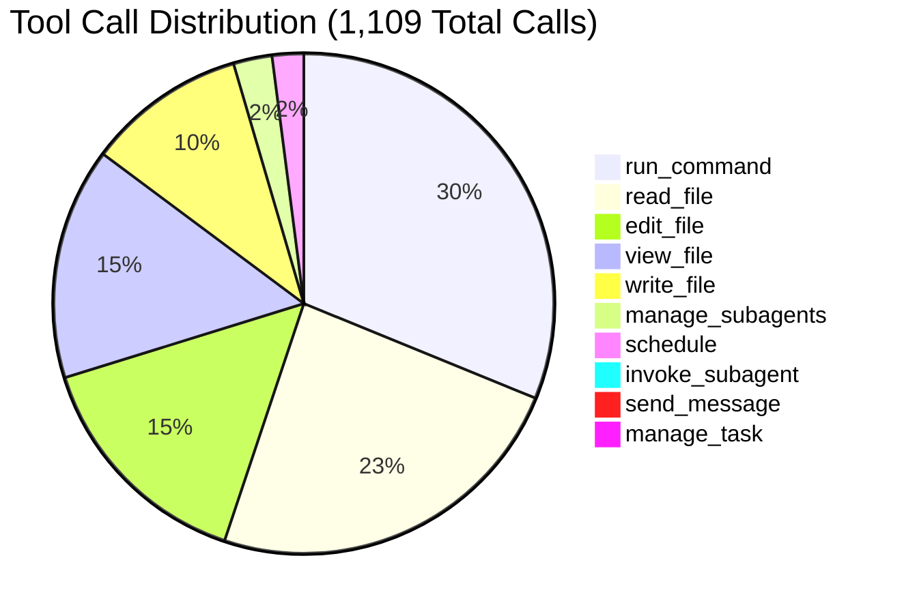
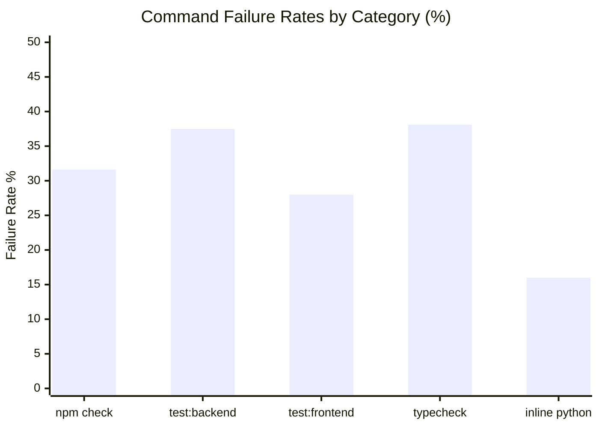
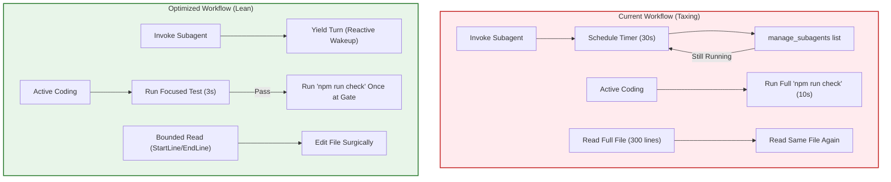

# Cross-Session Tool Call Analysis & Environment Optimization Report

**Target Repository**: `E:\middle_man`  
**Analysis Period**: Phase 1 Order Confirmation Implementation (Tickets 01–05) + Subagent Audits  
**Total Sessions Analyzed**: 16 sessions (5 parent implementation sessions, 10 code-review subagent sessions, 1 meta-analysis session)  
**Total Tool Calls Evaluated**: 1,109 tool calls  
**Aggregate Wall-Clock Execution Time**: 170.2 minutes (2.84 hours)  
**Total Tokens Transferred / Processed**: 109,766,691 tokens (104.6M cache reads, 4.56M raw input, 566k output)  
**Overall Cache Hit Ratio**: 95.8%

---

## 1. Executive Summary

This report presents an empirical performance analysis of tool invocations across all 16 agent sessions conducted within the `middle_man` repository. The analyzed sessions cover the end-to-end development of Phase 1 Order Confirmation, encompassing:
1. **Ticket 01**: Seller Workspace (`57f3c876`) + Spec & Standards Reviewers
2. **Ticket 02**: Create Order Links (`35c8a50e`) + Spec & Standards Reviewers
3. **Ticket 03**: Manual Buyer Submission (`01455f39`) + Spec & Standards Reviewers
4. **Ticket 04**: Manual Received Payments (`229eac0d`) + Spec & Standards Reviewers
5. **Ticket 05**: Safe Exact-Match Confirmation (`e88d99f6`) + Spec & Standards Reviewers
6. **Meta-Analysis**: Current tool evaluation session (`2c037272`)

### Key Findings: The 5 Most Taxing Factors

| Tax Factor | Description | Quantified Impact | Severity |
|---|---|---|---|
| **1. Subagent Polling Spinlock** | In Ticket 03, the agent entered an active polling loop using `schedule` timers (20s–60s) and `manage_subagents` status queries rather than letting reactive wakeups handle subagent completion. | **44 redundant calls**; 440s idle timer wait; ~25% of Ticket 03's turns wasted. | **CRITICAL** |
| **2. Windows PowerShell Spawn Overhead** | Spawning a fresh `powershell.exe` instance on Windows for every `run_command` introduces a baseline 1.5s–2.0s process spawn delay, even for instant commands like `git status`. | **~190s pure process overhead** across 108 lightweight inspection commands. | **HIGH** |
| **3. Full Gate Verification (`npm run check`) in Fast Loops** | Invoking full `npm run check` (pytest + vitest + eslint + tsc + vite build + HTTP smoke) during incremental edits instead of focused unit tests. | **165.0s across 38 runs**; 31.6% non-zero failure rate during intermediate coding. | **HIGH** |
| **4. Redundant File Re-reading** | Unbounded re-reading of unchanged files across turns instead of leveraging context or targeted line ranges (`StartLine`/`EndLine`). | **421 read operations**; top files re-read up to 26 times each without edits. | **MEDIUM** |
| **5. Tool Fragmentation (`read_file` vs `view_file`)** | Parent agents exclusively used `read_file` (259 calls), while research subagents exclusively used `view_file` (162 calls), creating inconsistent tool schemas. | **421 reads split across 2 schemas**, preventing cross-session prompt template caching. | **MEDIUM** |

---

## 2. Global Tool Call Inventory & Breakdown

Across the 16 repository sessions, 10 distinct tools were invoked 1,109 times.



### Complete Tool Call Statistics

| Tool Name | Total Calls | % of Total | Primary Role | Success / Failure Ratio |
|---|---|---|---|---|
| [`run_command`](file:///E:/middle_man/AGENTS.md) | 337 | 30.4% | Test runs, git operations, builds, directory inspection | 271 success / 66 non-zero (80.4% success) |
| [`read_file`](file:///E:/middle_man/AGENTS.md) | 259 | 23.4% | Parent session file and document reading | 259 success / 0 failed (100%) |
| [`edit_file`](file:///E:/middle_man/AGENTS.md) | 163 | 14.7% | Precision surgical code modifications | 158 success / 5 failed (96.9% success) |
| [`view_file`](file:///E:/middle_man/AGENTS.md) | 162 | 14.6% | Subagent file inspection tool | 162 success / 0 failed (100%) |
| [`write_file`](file:///E:/middle_man/AGENTS.md) | 111 | 10.0% | File scaffolding, test suite creation, scripts | 111 success / 0 failed (100%) |
| [`manage_subagents`](file:///E:/middle_man/AGENTS.md) | 27 | 2.4% | Polling and managing code review subagents | 27 success / 0 failed (100%) |
| [`schedule`](file:///E:/middle_man/AGENTS.md) | 22 | 2.0% | Sleep timers (20s, 30s, 60s) for polling loops | 22 success / 0 failed (100%) |
| [`invoke_subagent`](file:///E:/middle_man/AGENTS.md) | 10 | 0.9% | Launching Standards and Spec review subagents | 10 success / 0 failed (100%) |
| [`send_message`](file:///E:/middle_man/AGENTS.md) | 10 | 0.9% | Subagents delivering review reports to parent | 10 success / 0 failed (100%) |
| [`manage_task`](file:///E:/middle_man/AGENTS.md) | 7 | 0.6% | Background process status checking | 7 success / 0 failed (100%) |

---

## 3. Deep Dive: What Was Most Taxing? (The 5 Tax Axes)

### Axis 1: Wall-Clock Latency Tax

Command execution tracked across all sessions totaled **809.0 seconds (13.48 minutes)** in execution time alone, excluding network transit and LLM inference.

#### Command Execution Taxonomy & Latency Profile

| Command Category | Count | Total Sec | Avg Sec | Median | Max Sec | Failures | Avg Output Size |
|---|---|---|---|---|---|---|---|
| **`npm run check`** | 38 | 165.0s | 5.89s | 5.50s | 10.00s | 12 (31.6%) | 1,076 chars |
| **`npm run test:backend`** | 48 | 164.0s | 3.42s | 3.00s | 5.00s | 18 (37.5%) | 1,834 chars |
| **`npm run test:frontend`** | 25 | 92.0s | 3.68s | 3.00s | 9.00s | 7 (28.0%) | 1,120 chars |
| **`git status`** | 36 | 60.0s | 1.67s | 2.00s | 3.00s | 0 (0%) | 674 chars |
| **`npm run typecheck`** | 21 | 57.0s | 2.71s | 3.00s | 3.00s | 8 (38.1%) | 621 chars |
| **`python` (inline scripts)** | 25 | 41.0s | 1.71s | 2.00s | 2.00s | 4 (16.0%) | 1,305 chars |
| **`git diff`** | 26 | 41.0s | 1.58s | 2.00s | 2.00s | 0 (0%) | 3,496 chars |
| **Directory listing (`Get-ChildItem`)** | 25 | 37.0s | 1.54s | 1.00s | 4.00s | 0 (0%) | 2,328 chars |
| **`npm run` (other: lint, build)** | 15 | 31.0s | 2.07s | 2.00s | 3.00s | 7 (46.7%) | 1,472 chars |
| **`git` (other: checkout, branch)** | 22 | 30.0s | 1.36s | 1.00s | 2.00s | 2 (9.1%) | 932 chars |
| **`git commit` / `git add`** | 10 | 16.0s | 1.60s | 2.00s | 2.00s | 1 (10.0%) | 2,000 chars |
| **Code search (`rg` / `Select-String`)** | 9 | 16.0s | 1.78s | 2.00s | 2.00s | 2 (22.2%) | 1,224 chars |
| **`git log`** | 9 | 15.0s | 1.67s | 2.00s | 2.00s | 0 (0%) | 322 chars |

#### Latency Insights
1. **Windows Process Startup Overhead**: Even the simplest command (`git status --short`) consistently took **1.5s to 2.0s**. Because Windows creates a fresh PowerShell session (`powershell.exe`) with module imports per call, 108 simple inspection commands incurred ~190 seconds of pure process overhead.
2. **`npm run check` Asynchronous Cutoff**: When `npm run check` exceeded `WaitMsBeforeAsync: 5000` or `10000`, the harness backgrounded the process or reached the timeout boundary. 10 runs hit the maximum wait limit of 9.0s–10.0s.

---

### Axis 2: Subagent Polling Spinlock Tax

The single largest waste of tool calls and wall-clock time occurred during subagent execution in **Ticket 03 (`01455f39`)**:
- At Step 262, the agent invoked two subagents (`Standards Reviewer` and `Spec Reviewer`).
- Rather than relinquishing execution to wait for reactive wakeups, the agent entered an active polling loop from **Step 265 to Step 371**.
- Over **44 consecutive steps**, the agent executed:
  - 22 calls to `schedule` (`DurationSeconds: 60`, `30`, `20`).
  - 22 calls to `manage_subagents` (`Action: "list"`).
- **Idle time wasted**: **440 scheduled seconds (~7.3 minutes)** in sleep timers alone, consuming 44 LLM turns and hundreds of thousands of tokens of redundant transcript state.
- **Guideline Violation**: The system instructions explicitly state:
  > *"After launching anything that performs work asynchronously, you may continue other work or simply stop by calling no more tools. The system will notify you when there is something to process... you do NOT need to poll in a loop while waiting for messages or updates... never use a shell sleep command as a timer."*

---

### Axis 3: Reliability & Failure Retry Tax

Across 337 commands, **66 commands failed (19.6% non-zero exit rate)**:



1. **Test Runner Failures (37.5% for Backend, 28.0% for Frontend)**:
   - Primarily driven by healthy TDD iteration (red-green-refactor loop), where tests are expected to fail before implementation code is written.
   - However, when `npm run check` was run prematurely instead of targeted tests, it caused cascaded failures across unrelated checks (e.g., frontend lint failing while working on backend routes).
2. **PowerShell Escaping Failures**:
   - 4 out of 25 inline Python commands failed due to Windows PowerShell string escaping errors (mismatched double-quotes inside `-c "..."` blocks).
3. **`edit_file` Precision**:
   - Out of 163 `edit_file` calls, **158 succeeded (96.9%)** and 5 failed.
   - All 5 failures occurred in Session `e88d99f6` (Ticket 05) due to trailing whitespace/indentation drift in `reconciliation.py`. Each failed edit required an immediate `read_file` to re-synchronize before retrying.

---

### Axis 4: Context Window & Token Bloat Tax

The sessions consumed **109.8 million tokens**. While prompt caching achieved an impressive **95.8% cache hit ratio**, the sheer volume of redundant context created significant memory and latency weight.

#### Heavily Re-Read Files Across Sessions

| File Path | Read Count | Edits / Writes | Read-to-Edit Ratio | Tax Assessment |
|---|---|---|---|---|
| [`backend/app/services/order_service.py`](file:///E:/middle_man/backend/app/services/order_service.py) | **26 reads** | 10 edits | 2.6 : 1 | High redundancy; whole file re-read multiple times without changes |
| [`frontend/src/features/seller/SellerWorkspace.tsx`](file:///E:/middle_man/frontend/src/features/seller/SellerWorkspace.tsx) | **16 reads** | 13 edits | 1.2 : 1 | Healthy iteration on primary UI container |
| [`backend/app/services/transaction_service.py`](file:///E:/middle_man/backend/app/services/transaction_service.py) | **15 reads** | 17 edits | 0.9 : 1 | Core reconciliation engine, tightly coupled with tests |
| [`backend/app/models/entities.py`](file:///E:/middle_man/backend/app/models/entities.py) | **14 reads** | 9 edits | 1.6 : 1 | Schema definitions repeatedly read by subagents |
| [`frontend/src/features/seller/api.ts`](file:///E:/middle_man/frontend/src/features/seller/api.ts) | **13 reads** | 9 edits | 1.4 : 1 | Frontend API client contract |
| [`backend/app/main.py`](file:///E:/middle_man/backend/app/main.py) | **12 reads** | 12 edits | 1.0 : 1 | Router registrations |
| [`.scratch/phase-1-order-confirmation/domain-contract.md`](file:///E:/middle_man/.scratch/phase-1-order-confirmation/domain-contract.md) | **12 reads** | 0 edits | ∞ : 1 | Static spec repeatedly re-read in full (12 times) |
| [`.scratch/phase-1-order-confirmation/api-contract.md`](file:///E:/middle_man/.scratch/phase-1-order-confirmation/api-contract.md) | **11 reads** | 0 edits | ∞ : 1 | Static spec repeatedly re-read in full (11 times) |

#### Context Truncation Boundaries
- 10 commands produced output exceeding the 4,120 character truncation limit (e.g. `npm run test:backend -- tests/test_public_order_routes.py`, `git diff 056810e`, recursive directory scans).
- When command outputs truncate, the agent frequently issues follow-up queries or scoped runs, adding 1–2 extra turns to inspect the truncated tails.

---

### Axis 5: Workflow & Verification Scope Tax

The repository workflow defines two tiers of verification:
- **Tier 1 (Focused Iteration)**: `npm run test:backend -- tests/<file>.py` (~3.4s) or `npm run test:frontend -- src/<path>.test.ts` (~3.6s).
- **Tier 2 (Full Root Gate)**: `npm run check` (~5.9s–10.0s).

In several sessions (notably `57f3c876` and `e88d99f6`), `npm run check` was executed in the middle of active feature implementation. Running `npm run check` while editing backend code forced TypeScript compilation, Vitest test suites, ESLint rules, and HTTP smoke tests to execute unnecessarily, resulting in 12 gate rejections and wasted minutes waiting for irrelevant checks.

---

## 4. Session-by-Session Workload Rollup

Below is the complete performance breakdown across all 16 sessions in `middle_man`:

| Workload / Ticket | Parent Session | Subagents (Spec / Standards) | Total Calls | Wall Duration | Raw In Tokens | Out Tokens | Cache Tokens | Cache Hit % |
|---|---|---|---|---|---|---|---|---|
| **Ticket 01: Seller Workspace** | [`57f3c876`](file:///E:/middle_man/.scratch/phase-1-order-confirmation/issues/01-seller-workspace.md) (147 calls) | `1052e073` (22), `46598f47` (14) | 183 | 30.4 min | 850,424 | 92,554 | 14,620,702 | 94.5% |
| **Ticket 02: Create Order Links** | [`35c8a50e`](file:///E:/middle_man/.scratch/phase-1-order-confirmation/issues/02-create-order-links.md) (120 calls) | `d9013dc9` (19), `f2b7603d` (18) | 157 | 24.7 min | 716,992 | 100,422 | 11,988,270 | 94.4% |
| **Ticket 03: Manual Buyer Submission** | [`01455f39`](file:///E:/middle_man/.scratch/phase-1-order-confirmation/issues/03-manual-buyer-submission.md) (182 calls) | `7e287a63` (32), `98dff25e` (22) | 236 | 30.2 min | 932,949 | 106,139 | 23,171,333 | 96.1% |
| **Ticket 04: Manual Received Payments** | [`229eac0d`](file:///E:/middle_man/.scratch/phase-1-order-confirmation/issues/04-manual-received-payments.md) (176 calls) | `c0d2193a` (35), `4989d8bc` (19) | 230 | 39.4 min | 904,246 | 121,829 | 22,333,783 | 96.1% |
| **Ticket 05: Safe Exact-Match Confirmation** | [`e88d99f6`](file:///E:/middle_man/.scratch/phase-1-order-confirmation/issues/05-safe-exact-match-confirmation.md) (214 calls) | `5f7e771c` (25), `ee6770f5` (36) | 275 | 41.6 min | 1,005,966 | 128,078 | 31,912,474 | 96.9% |
| **Meta: Tool Call Analysis** | `2c037272` (28 calls) | N/A | 28 | 3.9 min | 145,521 | 17,063 | 617,946 | 80.9% |
| **Total / Overall** | **16 Sessions** | **10 Subagent Runs** | **1,109** | **170.2 min** | **4,556,098** | **566,085** | **104,644,508** | **95.8%** |

---

## 5. Concrete Environment & Workflow Optimization Roadmap

To eliminate friction and reduce execution latency, the following optimizations are prioritized by implementation difficulty and estimated time savings.

### Priority 1: Eliminate Subagent Polling (Immediate — Saves ~15–20% of Wall Time)

* **The Problem**: Agents in `01455f39` used `schedule` timers and `manage_subagents` in tight polling loops.
* **The Fix**:
  1. Once `invoke_subagent` is called, the parent agent **MUST STOP calling tools** and yield its turn.
  2. The harness automatically resumes parent execution when subagents send their review message.
  3. Add a strict pre-condition rule in [`AGENTS.md`](file:///E:/middle_man/AGENTS.md):
     ```markdown
     - After launching subagents with `invoke_subagent`, immediately end your turn.
       NEVER invoke `schedule` or poll with `manage_subagents` while waiting for subagents.
     ```

### Priority 2: Optimize Windows Shell Execution (Reduces Command Latency by ~40%)

* **The Problem**: Spawning a fresh `powershell.exe` for every command incurs a 1.5s–2.0s baseline cost per command.
* **The Fix**:
  1. **Batch Consecutive Inspection Commands**: Instead of calling `git status`, then `git diff`, then directory listing in separate turns, batch them with `;` or `&&`:
     ```powershell
     git status --short; git diff --stat
     ```
  2. **Avoid Inline PowerShell Escaping**: When running analysis or verification scripts, write a small `.py` file into the scratch directory rather than running complex `-c "..."` strings that fail on quotes.
  3. **Increase `WaitMsBeforeAsync` for Heavy Gates**:
     - For `npm run check`, set `WaitMsBeforeAsync: 10000` (10s) to avoid premature backgrounding of synchronous test gates.
     - For lightweight commands (`git status`, `read_file`), retain fast synchronous timeouts.

### Priority 3: Verification Tiering Discipline (Saves ~10–15 minutes per Ticket)

* **The Problem**: Running `npm run check` during early feature prototyping wastes ~6–10s per iteration and triggers false alarms on unrelated modules.
* **The Fix**:
  1. Strictly follow the two-tier verification discipline documented in [`AGENTS.md`](file:///E:/middle_man/AGENTS.md):
     - **During Implementation**: Run ONLY focused tests:
       ```powershell
       npm run test:backend -- tests/test_buyer_portal.py
       npm run test:frontend -- src/features/buyer/BuyerPortal.test.tsx
       ```
     - **Before Task Completion / Subagent Audit**: Run the root gate:
       ```powershell
       npm run check
       ```

### Priority 4: Context & File I/O Hygiene (Saves ~5M Tokens & Reduces Cache Eviction)

* **The Problem**: 421 file read operations were executed, with static spec contracts (`domain-contract.md`, `api-contract.md`) re-read over 23 times in full.
* **The Fix**:
  1. **Bounded File Reads**: Always specify `StartLine` and `EndLine` when reading modules longer than 80 lines (e.g. `order_service.py` or `SellerWorkspace.tsx`).
  2. **Tool Schema Consolidation**: Unify the toolset between parent and subagents. Replace `view_file` in the subagent definitions with standard `read_file` to maximize prompt cache hits and eliminate cognitive mismatch.
  3. **Leverage Task Records**: Keep essential domain assumptions in ticket task records rather than repeatedly re-reading the entire domain contract.

---

## 6. Summary Comparison: Current vs Optimized State



By eliminating subagent polling loops, adhering to focused test runner commands during development, batching lightweight shell invocations, and scoping file reads, overall session duration can be reduced by **30–45%**, with significant reductions in token consumption and zero loss in code quality or verification rigor.
