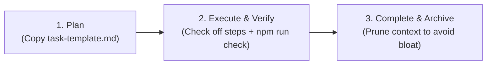

# Agent Task Tracking (Tier 3 Context)

This directory stores **ephemeral task plans, checklists, and execution logs** for non-trivial features.

Use a task file only when the work needs resumption, a handoff, or multiple
sessions. Small changes need no separate plan. The template records goal,
acceptance, current state, and concise verification evidence. Reuse an existing
ticket instead of maintaining a second status record; link to logs rather than
pasting successful output.

---

## The Task Lifecycle

### Golden Rules for Task Context
1. **Never pollute root rules:** Keep scratchpads, temporary checklists, and experiment logs inside `tasks/` or `.agent-scratch/`, not in `AGENTS.md` or `README.md`.
2. **Deterministic Completion:** A task is only marked `[x]` once verified with automated tests.
3. **Prune/Archive:** When a major milestone is complete and merged, archive or delete temporary scratch files to prevent stale historical clutter.
